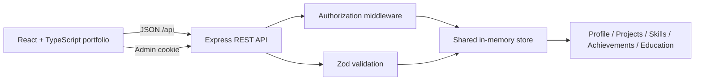
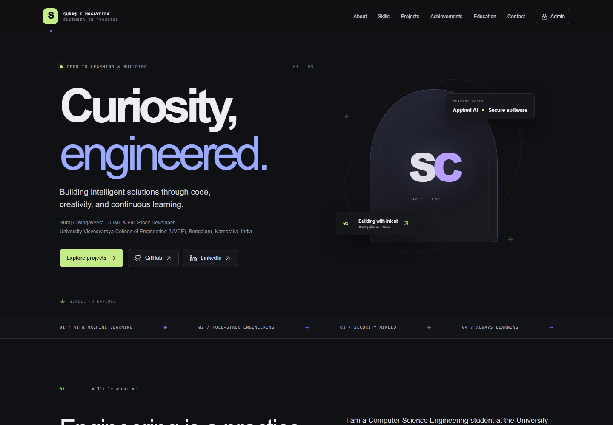
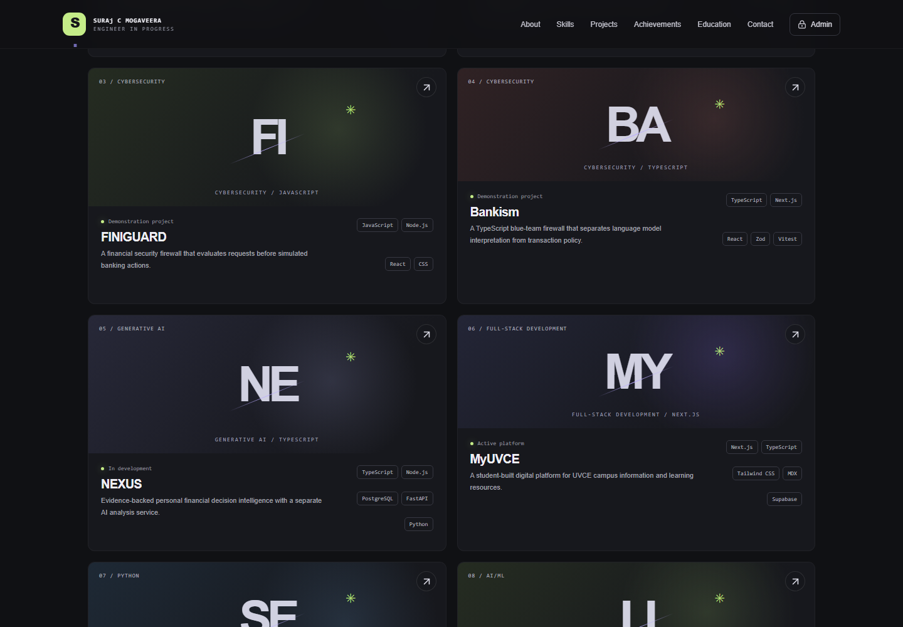
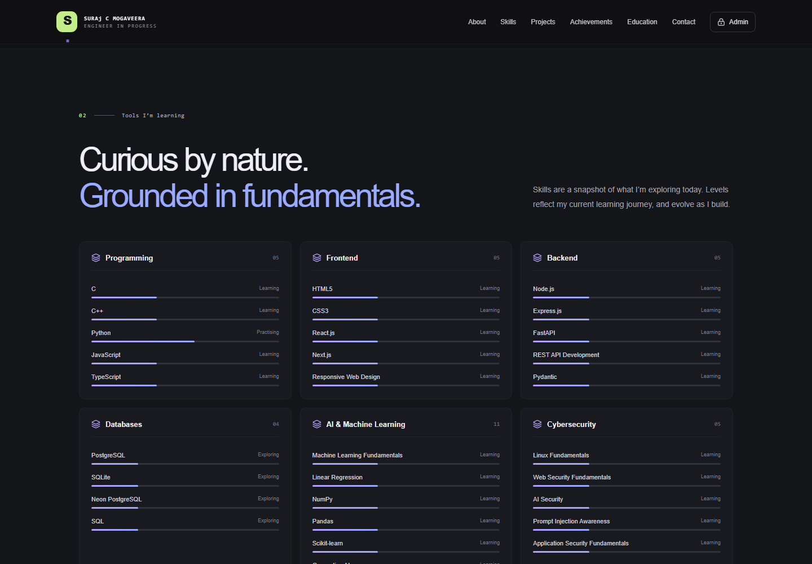
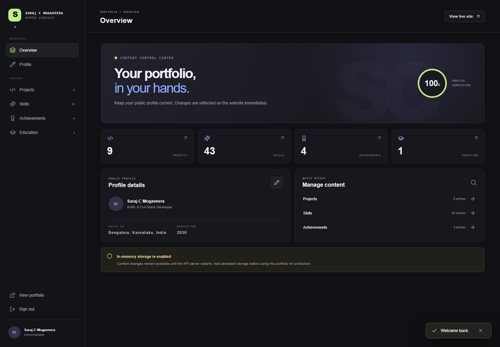
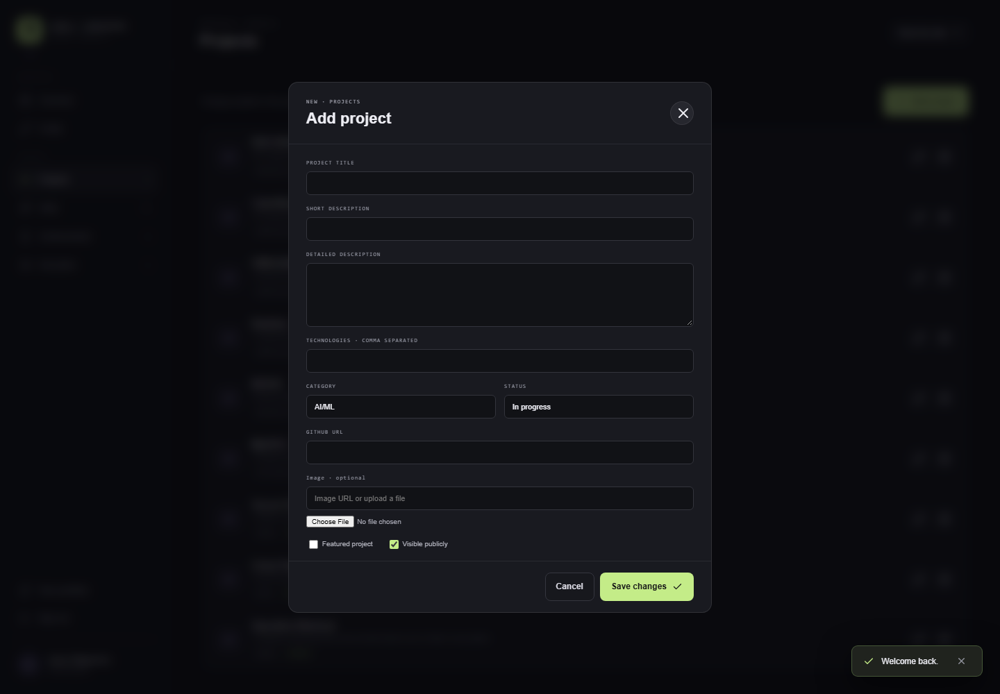
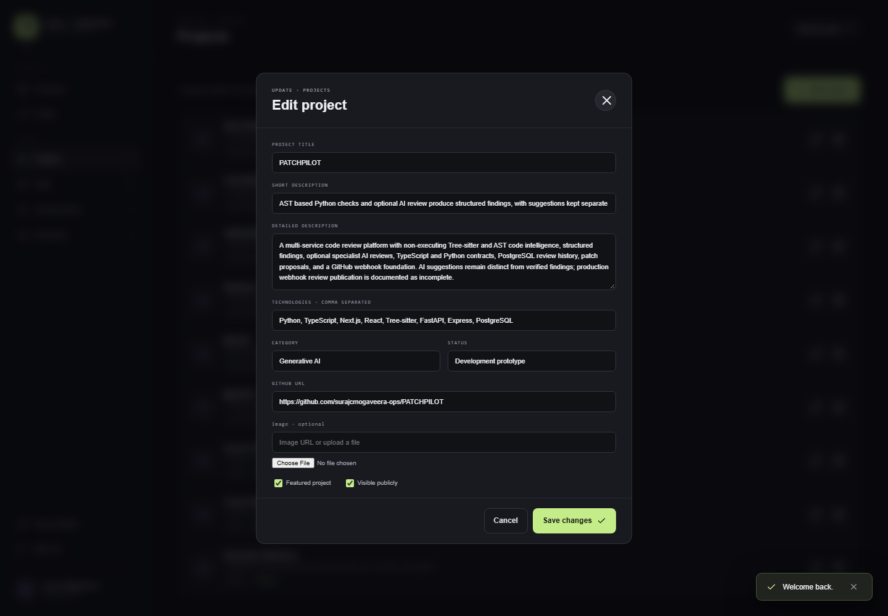
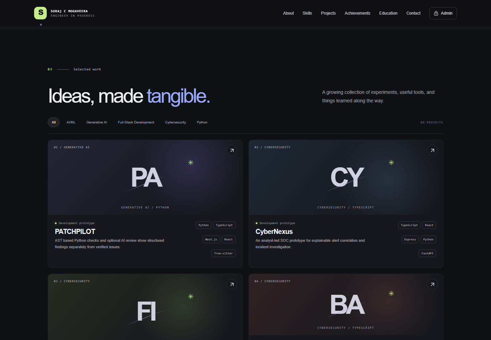
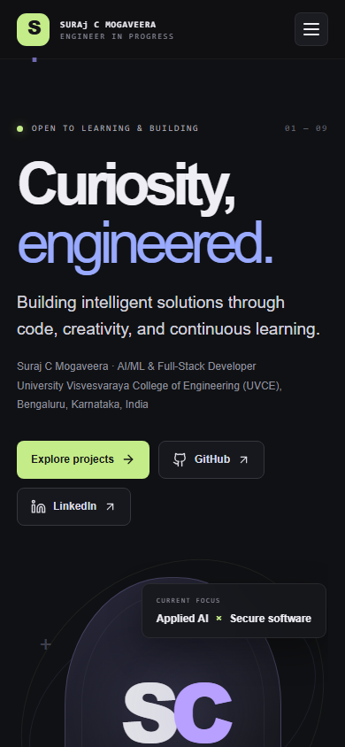
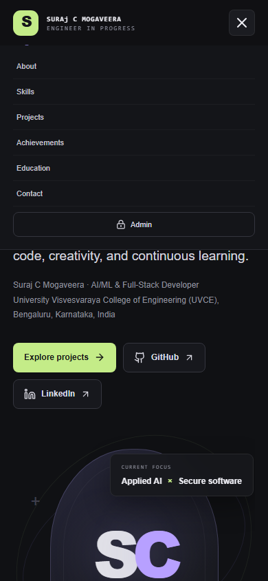

# Suraj C Mogaveera · Portfolio

A responsive developer portfolio and authenticated admin dashboard for managing profile content, projects, skills, achievements, and education.

## Features

- Dark editorial portfolio with responsive navigation, project category filters, skill groups, achievement cards, education, and contact links.
- Project detail panels with direct links to the verified GitHub repositories, plus the repository's genuine output image for Operation Blackout.
- Admin dashboard at `/admin` with protected profile editing and CRUD for all content collections.
- REST API with Zod validation, structured JSON responses, centralized errors, CORS allowlisting, Helmet headers, and server-side authorization.
- Scrypt password verification and an eight-hour signed, HTTP-only, SameSite strict admin cookie.
- Upload profile and project images through the admin file controls (images are stored as data URLs in memory; keep files under 3 MB).
- Seeded content uses the owner information and repository descriptions checked against the supplied GitHub repositories. FINIGUARD and Bankism are listed as separate implementations; MyUVCE is identified as collaborative work.

## Architecture



## Screenshots

The screenshot set covers the homepage, projects, skills, admin overview, add/edit project forms, the public portfolio after an admin update, and mobile navigation.



















The React app and Express API run as separate local services. The browser reads the public data from the API and sends admin changes to the same store.

## Tech stack

- Frontend: React 19, TypeScript, Vite, custom responsive CSS, Lucide React
- Backend: Node.js, Express, TypeScript (run with `tsx`)
- Validation and security: Zod, Helmet, CORS, Node `scrypt` and HMAC
- Data: in-memory JavaScript objects
- Tests: Node built-in test runner and HTTP integration checks

## Folder structure

```text
src/                 React application, API client, and visual styles
server/data.ts       Seed profile and portfolio data
server/index.ts      Express API, validation, auth, and CRUD routes
tests/               API integration tests
scripts/             Local admin credential helper
```

## Run locally

Requirements: Node.js 20.19+ (Node 22+ recommended) and npm.

1. Install dependencies: `npm install`
2. For a ready local demonstration, run `npm run admin:setup`. It creates an ignored `.env` with a generated password hash and session secret, then prints the random password once. Save it somewhere private. Or copy `.env.example` and set values manually.
3. To choose your own password, generate a hash with `npm run admin:hash` and copy its output into `ADMIN_PASSWORD_HASH` in `.env`.
4. If setting up manually, generate a session secret, for example:

   ```powershell
   node -e "console.log(require('node:crypto').randomBytes(32).toString('hex'))"
   ```

   Put the output in `SESSION_SECRET`.

5. Start both services: `npm run dev`
6. Open `http://localhost:5173`. The admin dashboard is at `http://localhost:5173/admin` and the API listens on `http://localhost:4000`.

The password helper reads the new password in visible terminal input. Do not paste secrets into source files or commit `.env`.

## Admin dashboard

Sign in with the password used to create `ADMIN_PASSWORD_HASH`. The dashboard provides overview counts and profile completion, profile editing, and create/edit/delete controls for projects, skills, achievements, and education. Project controls include category, technologies, repository URL, image upload, featured status, and public visibility. Delete actions ask for confirmation. Invalid input returns a validation message and successful writes refresh the shared API data.

## API

Public routes:

| Method | Route | Purpose |
| --- | --- | --- |
| GET | `/api/health` | Liveness check |
| GET | `/api/profile` | Read profile and social links |
| GET | `/api/projects` | List visible projects |
| GET | `/api/projects/:id` | Read a visible project |
| GET | `/api/skills` | List skills |
| GET | `/api/achievements` | List achievements |
| GET | `/api/education` | List education records |
| GET | `/api/auth/session` | Check current admin session |

Admin routes require the signed session cookie, except sign-in and sign-out:

| Method | Route | Purpose |
| --- | --- | --- |
| POST | `/api/auth/login` | Verify admin password and start session |
| POST | `/api/auth/logout` | Clear session cookie |
| PUT | `/api/profile` | Update profile |
| POST / PUT / DELETE | `/api/projects[/:id]` | Manage projects |
| POST / PUT / DELETE | `/api/skills[/:id]` | Manage skills |
| POST / PUT / DELETE | `/api/achievements[/:id]` | Manage achievements |
| POST / PUT / DELETE | `/api/education[/:id]` | Manage education records |

Successful responses use `{ "data": ... }`. Errors use `{ "error": { "code", "message", "details?" } }`. Validation errors return 400, unauthenticated writes 401, missing records 404, and creates 201.

## Environment variables

| Name | Required | Description |
| --- | --- | --- |
| `PORT` | No | API port (default `4000`) |
| `CLIENT_ORIGIN` | No | Comma-separated allowed browser origins (default `http://localhost:5173`) |
| `ADMIN_PASSWORD_HASH` | Yes for admin | Salt and scrypt digest produced by `npm run admin:hash` |
| `SESSION_SECRET` | Yes for admin | Random secret used to sign session cookies |
| `NODE_ENV` | No | Set to `production` to enable the cookie Secure flag |
| `VITE_API_URL` | For separate hosting | API base URL including `/api`, set at frontend build time |

## Tests and build

```sh
npm test
npm run build
```

To capture the documented browser screenshots and run the mobile overflow/navigation check, start the app, set `ADMIN_DEMO_PASSWORD` to the local admin password, and run `npm run screenshots`. This uses the installed Chrome executable (or set `CHROME_PATH`). The screenshot script briefly edits the verified PATCHPILOT summary for the public-after-update image, then restores it in a `finally` block.

The integration test starts a local API process and checks authentication, rejected writes, validation, create/delete for each collection, project updates, and public reads after an admin update.

## Deployment

No deployment URL is configured. For a demonstration deployment, build the Vite frontend as static assets and host the API as a Node service (for example, Render). Set `VITE_API_URL` before building the frontend. Set `CLIENT_ORIGIN` to the exact deployed frontend origin, plus `ADMIN_PASSWORD_HASH`, `SESSION_SECRET`, `NODE_ENV=production`, and `PORT` on the API service. Because the admin cookie is SameSite strict, keep the frontend and API under the same registrable site when hosting them on separate subdomains. Confirm provider-specific routing and static fallback behavior before publishing.

## Known limitations

- The backend uses in-memory data. **All admin changes disappear when the API process restarts.** No database or file persistence is implemented, and the store is not suitable for production use.
- Admin authentication is intentionally a basic single-admin setup. Add rate limiting, password rotation, durable session management, and operational monitoring before public production exposure.
- Images are held in memory as data URLs and disappear on API restart.
- The portfolio includes no invented email, demo links, usage metrics, or deployment claims.
- Project descriptions reflect the linked repositories as reviewed during implementation; repository content can change over time.

## Future improvements

- Replace memory storage with PostgreSQL and add schema migrations.
- Add managed authentication, login throttling, and audit history.
- Store uploaded images in object storage.
- Add accessibility checks and browser-level regression coverage to CI.
